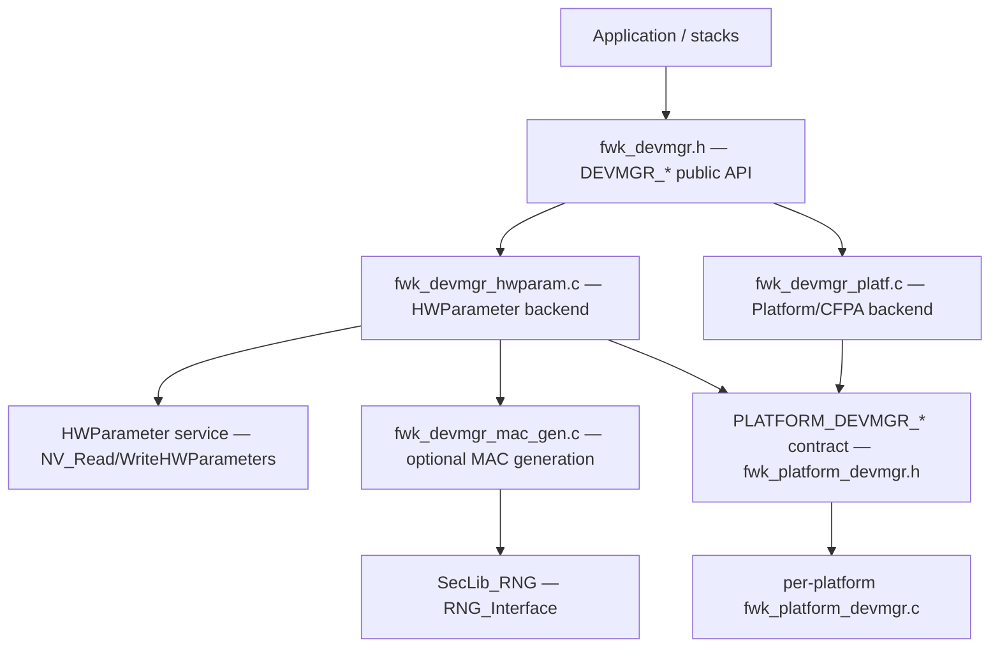

# DevMgr - Manufacturing Data Abstraction Module

## Overview

DevMgr is the entry point for accessing manufacturing-related device
information (BD address, IEEE 802.15.4 address, crystal trim values and future
provisioning data). It abstracts the underlying storage backend behind a single
stable public `DEVMGR_*` API.

## Public API

| Get API | Set API |
|---|---|
| `DEVMGR_GetBdAddress`  | `DEVMGR_SetBdAddress`  |
| `DEVMGR_Get154Address` | `DEVMGR_Set154Address` |
| `DEVMGR_Get32MHzTrim`  | `DEVMGR_Set32MHzTrim`  |
| `DEVMGR_Get32kHzTrim`  | `DEVMGR_Set32kHzTrim`  |

## Get APIs

Behavior of a `DEVMGR_Get*`:

1. Read the parameter from the backend.

### Address Get APIs

`DEVMGR_Get*Address` APIs take an optional `uint32_t *from_location` in/out
argument selecting/reporting the address source (`DEVMGR_MAC_SRC_*`).
If `from_location` is a NULL pointer, or its value is `0` or `DEVMGR_MAC_SRC_ANY`,
the possible sources are read in order of precedence: CUST backend
(HWParameter or CFPA) -> NMPA -> UUID.

1. If the `from_location` mask has the `DEVMGR_MAC_SRC_CUST` bit, read the
   parameter (address octet string) from the backend.
2. If the parameter is **not blank**, copy it to the output, set
   `from_location` to `DEVMGR_MAC_SRC_CUST` and return `DEVMGR_Success_c`.
3. If the parameter **is blank** (all `0xFF`) and the `from_location` mask has
   the `DEVMGR_MAC_SRC_NMPA` bit:
   - read the octet string from NMPA,
   - if provisioned copy it to the output,
   - set `from_location` to `DEVMGR_MAC_SRC_NMPA` and
   - return `DEVMGR_Success_c`.
4. If the parameter is blank again and the `from_location` mask has the
   `DEVMGR_MAC_SRC_UUID` bit and the UUID octet string is **not blank**:
   - copy the derived MAC address (derived from `CRC32(UID)`),
   - set `from_location` to `DEVMGR_MAC_SRC_UUID` and
   - return `DEVMGR_Success_c`.
5. If the build option `DEVMGR_MAC_GEN_ENABLED` is enabled (HWParameter backend
   only) and the `from_location` mask has the `DEVMGR_MAC_SRC_CUST` bit:
   - generate a random MAC address,
   - set it permanently in the backend by calling `DEVMGR_Set*Address`,
   - copy it to the output,
   - set `from_location` to `DEVMGR_MAC_SRC_CUST` and
   - return `DEVMGR_Success_c`.
   The platform/CFPA backend never generates an address.
6. Otherwise (`DEVMGR_MAC_GEN_ENABLED` not enabled, and none of the
   `from_location`-specified methods produced an address):
   - fill the output with `0xFF`,
   - return `DEVMGR_Blank_c` (read-only behavior, nothing is written).

## Return status

| Status | Meaning |
|---|---|
| `DEVMGR_Success_c`      | Operation completed successfully |
| `DEVMGR_Error_c`        | Generic error (backend read/write failure or bad argument) |
| `DEVMGR_Blank_c`        | Parameter is empty (all `0xFF`) and no source provided a value |
| `DEVMGR_NotSupported_c` | Parameter not supported by the active backend |

## Architecture

## Files

| File | Description |
|---|---|
| `fwk_devmgr.h`               | Public API and return-status types |
| `fwk_devmgr_hwparam.c`       | HWParameter storage backend implementation |
| `fwk_devmgr_platf.c`         | Platform/CFPA storage backend implementation |
| `fwk_devmgr_mac_gen.c/.h`    | Optional MAC-address generation service (OUI + RNG / CRC32(UID)) |
| `Kconfig`                    | Build configuration options (backend selection) |
| `CMakeLists.txt`             | Build integration |
| `fwk_platform_devmgr.h`      | Per-platform `PLATFORM_DEVMGR_*` contract and shared MAC-gen macros (in `platform/include/`) |
| `platform/<soc>/fwk_platform_devmgr.c` | Per-platform `PLATFORM_DEVMGR_*` implementation |
| `platform/kw43_mcxw70/fwk_platform_ifr.c/.h` | KW43/MCXW70 CFPA/CMPA IFR transactional flash engine backing the platform store |

## Backend status per platform

| Platform | Default backend | Notes |
|---|---|---|
| KW45x / K32W1x / MCXW71x | HWParameter | |
| KW47x / MCXW72x          | HWParameter | |
| MCXW23                   | Platform / CFPA | CFPA is the active backend on this family |
| KW43 / MCXW70            | HWParameter | The platform/CFPA backend is **implemented but not yet active**. On KW43/MCXW70 the interim default remains HWParameter; the CFPA-store accessors in `platform/kw43_mcxw70/fwk_platform_devmgr.c` and the backing IFR engine (`fwk_platform_ifr.c`) are compiled only when the platform backend is explicitly selected (`MCUX_COMPONENT_middleware.wireless.framework.devmgr_plat`). The backend is not yet wired as the KW43/MCXW70 default and does not change the active address path; enabling it as the default is planned for a later stage. |

